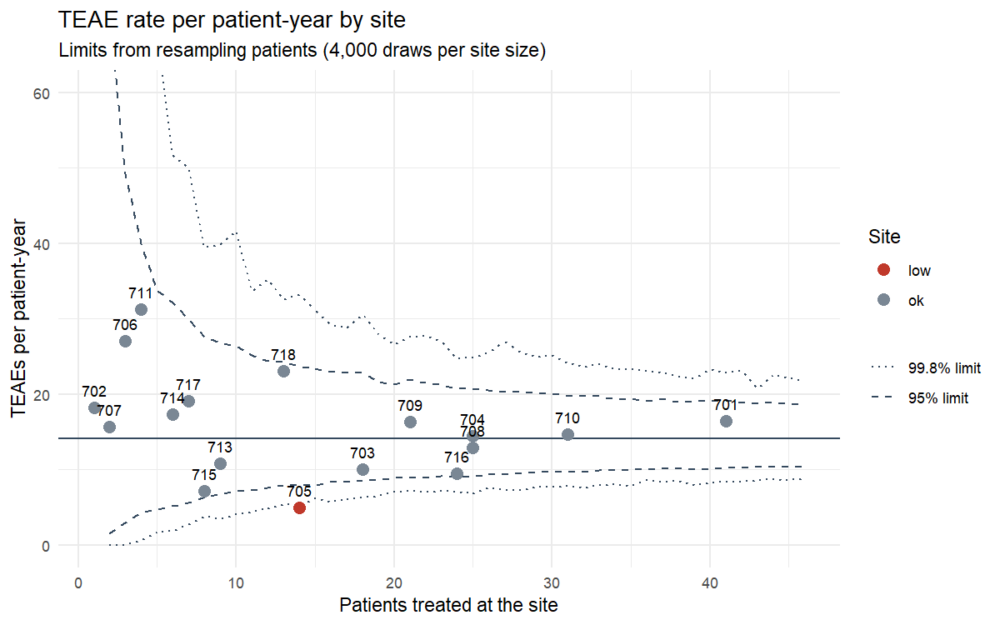
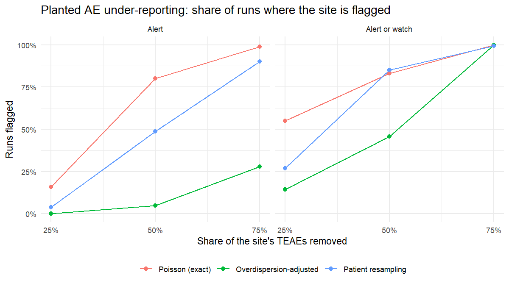
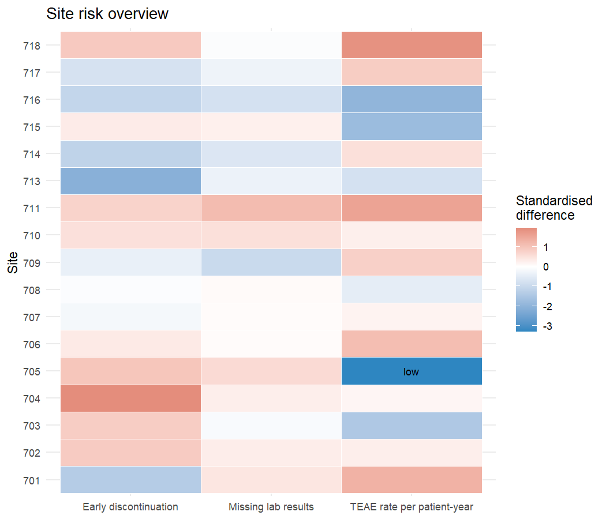

# Centralized Monitoring of a Clinical Trial in R

Site-level key risk indicators for the CDISC pilot study (an anonymised
Alzheimer's trial of xanomeline published for open use), built the way a
sponsor's central monitoring team works under ICH E6(R2) risk-based
monitoring: SDTM → ADaM datasets with **{admiral}**, one risk indicator per
site, funnel plots, and a test of whether the method actually catches a site
that under-reports adverse events.

**Stack:** R 4.6 · admiral · pharmaversesdtm · dplyr / tidyr · ggplot2 · testthat · jsonlite

## What it does

1. **ADaM datasets** (`R/adam.R`). ADSL from DM, EX and DS: first and last
   dose dates, treatment duration, safety flag, end-of-study status and
   reason. ADAE from AE: imputed analysis dates and the treatment-emergent
   flag (onset from first dose to 30 days after the last).
2. **Three key risk indicators per site** (`R/kri.R`):
   - treatment-emergent AE rate per patient-year,
   - early discontinuation,
   - missing lab results.
3. **Control limits that respect the data.** Proportions use exact binomial
   limits. The AE rate does not, because AEs cluster within patients (see
   below), so each site is compared with thousands of same-sized "sites"
   resampled from the other sites' patients (`R/resample.R`).
4. **A planted-fault test** (`R/underreporting.R`). The pilot data have no
   known misconduct, so one is made: a share of one site's AEs is deleted at
   random, everything is re-run, and the site either is flagged or is not.
   Every site with at least 10 patients that the method calls normal is
   tested, at 25%, 50% and 75% removed, 20 random draws each.

## Results (from `output/report.json`)

The data: 254 treated patients, 17 sites, 79.5 patient-years on treatment,
1,122 treatment-emergent AEs, 59,580 lab results. Study rates: 14.1 TEAEs per
patient-year, 56.7% discontinued early, 1.5% of lab results missing.

**One site stands out.** Site 705 reports 4.9 TEAEs per patient-year against
14.1 for the study: 20 events where about 57 would be expected. That is below
the 99.8% limit for a 14-patient site. A flag is a reason for a monitor to
look (under-reporting, or a genuinely different population), not a finding.
No site differs on discontinuation or missing lab results; the lab indicator
is flat at about 1.5% everywhere, which also shows the method does not raise
alarms where there is nothing to see.



### Why the AE limits are resampled

The textbook funnel plot treats every AE as an independent Poisson event. In
this trial a few patients carry many AEs, so counts vary far more than
Poisson allows: the overdispersion factor across sites is **4.83**. Three
ways of drawing the limits, measured on the same data:

| Method | Sites flagged on the untouched data | Site flagged when it hides 50% of AEs | when it hides 75% |
|---|---|---|---|
| Poisson, exact limits | 4 (plus 5 on watch) | 80% | 99% |
| Overdispersion-adjusted (Spiegelhalter) | 0 (2 on watch) | 5% | 28% |
| **Patient resampling** | **1** | **49%** (85% incl. watch) | **90%** |

Poisson limits look sensitive only because they flag a quarter of the sites
before anything is wrong. Inflating them by the spread between sites stops
the false alarms but also absorbs the real site differences monitoring is
meant to find. Resampling patients keeps the clustering inside patients and
nothing else, and it is the only one of the three that is both quiet on the
untouched data and catches heavy under-reporting. Hiding a quarter of a
site's AEs is not reliably detectable at these site sizes by any of the
three (at most 16% of runs flagged at the alert level).





## Run it

```r
install.packages(c("admiral", "pharmaversesdtm", "dplyr", "tidyr", "ggplot2",
                   "readr", "jsonlite", "testthat"))
```

```sh
Rscript run.R              # writes output/ (about 80 s)
Rscript tests/testthat.R   # 26 checks
```

## Outputs

| File | Contents |
|---|---|
| `output/adsl.csv`, `output/adae.csv` | the analysis datasets |
| `output/site_kris.csv` | every site × indicator: value, expected, flag |
| `output/site_teae_resampled.csv` | AE rate, reference range and percentile per site |
| `output/underreporting_runs.csv` | all 1,200 planted-fault runs |
| `output/report.json` | the numbers quoted above |
| `output/*.png` | funnel plots, heatmap, detection curves |

## Limits

- One study, 17 sites. The detection rates depend on site size; the largest
  site here has 41 patients.
- The resampled reference is the other sites. If most sites under-reported,
  the reference would move with them.
- The planted fault deletes AEs at random. Real under-reporting is often
  selective (mild events first), which a severity-mix indicator would catch
  better than a rate.
